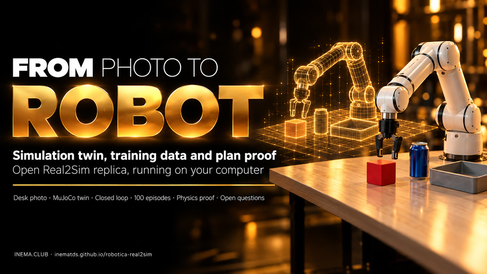

# robotica-real2sim

[](https://inematds.github.io/robotica-real2sim/guia/en/)

**From a photo of a table to a simulation twin, to labeled training data, and proof of the plan
before the real robot moves.** An open, local replica of the “Real2Sim” idea Google showed in the
robotics segment of Gemini 4 Argon (13/10/2026), built with MuJoCo, the MuJoCo Menagerie Franka
Panda arm, and Codex via subscription instead of Argon.

[🇧🇷 Português](README.md) · 🇺🇸 English · [🇪🇸 Español](README.es.md) · [Illustrated guide](https://inematds.github.io/robotica-real2sim/guia/en/)

## What it is

robotica-real2sim is an open project that reproduces on your computer the idea Google showed in the robotics part of Gemini 4 Argon: take a photo of a table and turn it into a physics simulation where a robot arm trains. It is for anyone who wants to understand and test AI robotics without owning a robot. It builds the table's "twin", generates dozens of labeled training attempts and tests every plan in simulation before sending it to a real robot. It needs Python, MuJoCo (a free simulator) and, to read the photo, Codex.

> **An educational replica, not Argon.** The code here does not call the Gemini API. It reproduces the
> *workflow* Google described (photo → MuJoCo scene → closed-loop motion generator →
> varied episodes → proof in physics) with open tools, and measures what runs. What Google
> measured with Argon is in [docs/PESQUISA.md](docs/PESQUISA.md), with sources.

## What it does

```
photo.jpg ──(vision model)──> scene.json ──> MuJoCo twin (Panda + table + objects)
                                                  │
           "put everything round in the tray"     ├──> closed-loop motion generator (IK)
                         │                         ├──> 50 varied episodes + 4-level annotation
                 (Codex plans)                     └──> episode film (3 cameras)
                         ▼
                   plan.json ──> PROOF: 20 physics variations ──> PASSED / FAILED
```

| Stage | Command | Output |
|---|---|---|
| Photo → scene | `./r2s.py foto foto.jpg cena.json` | objects, sizes, and positions in meters, calibrated with an A4 sheet |
| View the twin | `./r2s.py ver cena.json gemeo.png --camera cima` | simulation image for comparison with the photo |
| Film | `./r2s.py filmar cena.json ep.mp4 --cameras geral,cima,pulso` | MP4 with the phase displayed on screen |
| Data | `./r2s.py episodios cena.json saida/ -n 50 --imagens` | `ep_NNNN.npz` (joints, gripper, TCP, object, images) + `ep_NNNN.json` (annotation) |
| Plan | `./r2s.py planejar cena.json "pedido" plano.json` | pick → destination steps written by Codex |
| Prove | `./r2s.py provar cena.json plano.json -n 20` | success rate, failure by step, PASSED if ≥ 90% |
| Everything | `./r2s.py tudo foto.jpg pasta/` | the first four stages at once |

## Measured results (14/10/2026, 20-core ARM CPU, MuJoCo 3.15)

| Measure | Result |
|---|---|
| Photo → scene (Codex, `gpt-6-luna`) | 4 objects in ~9 s, cube on the left and tray on the right as in the photo |
| `mesa-foto` episodes (cube → tray, with variation) | **50/50** in 12.4 s |
| `mesa-teste` episodes | **50/50** in 10.3 s |
| Each object alone (cube, can, ball × 2 scenes, 20 variations) | **20/20** for all |
| Codex plan “put everything round in the tray,” naive | **4/20 (20%) → FAILED**: the ball falls on top of the can |
| Same plan with one slot per object | **19/20 (95%) → PASSED** |
| Same plan with the tray 15% smaller (`--pior-caso`) | 19/20, but the Codex tray is still bigger than the real one |
| Codex plan in the smallest measured tray (15×15, Argon) | **2/20 → FAILED** |
| Tests (`python3 testes/rodar.py`) | 12/12 |

Files: [resultados/](resultados/) (summaries, plan, proofs, and the 100 episodes).


**Codex × Claude × Gemini:** the same photo and request ran on Codex, Claude (`--motor claude`), Gemini Robotics-ER 2 (`--motor gemini`) and Gemini 4 Argon via OpenRouter (`--motor openrouter`). Claude, ER and Argon measured the table faithfully; Argon was the only one with a faithful scene and an approved plan (100%), in 7 s for US$ 0.01. Details in [docs/CODEX-VS-CLAUDE.md](docs/CODEX-VS-CLAUDE.md) (in Portuguese).

**Measurement error:** the proof now also varies size (`--var-tamanho 0.15`, `--pior-caso`), and `ferramentas/matriz_prova.py` runs each plan order in every model's scene. Only 2 of the 8 pairs pass every mode (one of them in Codex's inflated scene); new rule: only what passes the worst case and the smallest plausible tray goes to the robot. Details in [docs/ERRO-DE-MEDIDA.md](docs/ERRO-DE-MEDIDA.md) (in Portuguese).

**Reasoning effort (`--esforco`):** the same `gpt-6-luna`, 3 runs at each level. At medium effort it inflates everything 1.6× in all 3 runs (10 cm cube, bigger than the gripper; cube–tray ~78 cm). At high it gets sizes right (6 cm cube, 20 cm tray) but squeezes distances (~28 cm), and in one run it forgot the cube. The plan was the same in all 4 runs. More effort changes the kind of error, it does not remove it.

**Astra, Sol and Fable (high effort, 3 runs each):** all three got the scale right in all 9 runs (cube–tray 45–47 cm). Astra was the most stable measurement (16–17 cm tray, 35–48 s). Fable passed can→ball 20/20 in all 3 scenes, but takes 2–3 min. Switching model mattered more than switching effort. All of them planned can→ball, and none passes the worst case: what is missing is physics (lay the can down), not a model.

**Practical lessons:** (1) run vision 3 times, because large disagreement means a bad measurement; (2) read the `r2s.py foto` warnings ("wider than the gripper", "positions reduced"); (3) prove in the worst case and in the smallest plausible scene; (4) pick the vision model first, then the effort, and keep the default (`medium`) for the plan; (5) test both step orders; (6) a tape measure is worth more than switching models. **Lying can (`--deitar`):** in the 18×22 tray both plan orders now pass the worst case (19/20); in the 18×18 tray one gets worse, and in the 15×15 tray the can barely fits. The proof should choose upright vs. lying, scene by scene.

## Install and run

```bash
git clone https://github.com/inematds/robotica-real2sim && cd robotica-real2sim
./instalar.sh                     # venv + MuJoCo + Menagerie Panda + tests
./r2s.py filmar exemplos/mesa-teste/cena.json ep.mp4 --cameras geral,cima,pulso
./r2s.py provar exemplos/mesa-foto/cena.json resultados/mesa-foto/plano.json --sem-vagas
./r2s.py provar exemplos/mesa-foto/cena.json resultados/mesa-foto/plano.json
```

Without a monitor (server, WSL), rendering uses `MUJOCO_GL=egl`; without a GPU, `MUJOCO_GL=osmesa`.
The **photo → scene** and **planning** stages use the Codex CLI (`codex login`). Without it, write
`cena.json` by hand (template at [exemplos/mesa-teste/cena.json](exemplos/mesa-teste/cena.json)) or paste the
`PROMPT` from [real2sim/foto2cena.py](real2sim/foto2cena.py) into any chat with vision.

## How it works inside

- **`cena2mjcf.py`** builds the MJCF with `MjSpec`: the Menagerie Panda, a table, lights, three cameras
  (general, overhead, wrist-mounted), and the objects. It rejects scenes outside the arm’s reach (0.25–0.80 m).
- **`gerador.py`** is the closed-loop motion generator: every 20 ms it reads where the object is,
  recalculates the target, and solves differential inverse kinematics (damped least squares, rest
  posture only in the null space, integrated command with anti-windup). Phases: approach, descend, close,
  lift, carry, lower, open, retreat. Success is checked by the physics (object inside the container).
- **`episodios.py`** samples variations (position ±4 cm, rotation ±0.6 rad, mass ±30%) and records each
  episode with “in retrospect” annotation at 4 levels: objective → subtasks (pick, carry, release)
  → primitives with start and end → events (contact by both fingers, object lifted, success). A failed
  episode gets `peso_no_treino: 0`, like the quality control in Google’s ALOHA 2 example.
- **`provar.py`** asks Codex for the plan, checks that it only mentions existing objects, assigns slots in
  the container, and runs the plan N times with variation. It only passes above the minimum.

## What Google showed (summary; sources in [docs/PESQUISA.md](docs/PESQUISA.md))

- **ERQA** (embodied reasoning): 87%, above every frontier model.
- **From a photo**: workbench with 2 Franka FR3 arms → MuJoCo twin → 77 tasks → closed-loop IK
  generator → 4,500+ episodes → VLA fine-tuning → **56% → 75%** success on the real robot, **35 s → 24 s**.
- **Spot** trains on the twin of a pedal bin before stepping on the real one; **SO-101** improves itself
  (58.9 s → 22.9 s → 17.4 s) under rules in an `AGENTS.md`; **ALOHA 2** gets 4-level annotation
  (1 objective, 6 subtasks, 17 primitives) with quality control.
- **DroneBench** (Andon Labs): models writing code for a US$ 129 drone to find and follow a
  person. The best model gets 84% of the way; nobody has completed all 5 tasks yet.
- Argon access: AI Studio (Ultra), paid Gemini API (`gemini-4-argon`), Antigravity.

## Questions this raises

Recursive self-improvement, cheap surveillance, robot jailbreaks, simulation that lies, data ownership, jobs, a model that writes its own proof, and regulation: each expanded with sources and what this repository measured, in **[docs/QUESTOES.md](docs/QUESTOES.md)**.

**Humanoids:** does Real2Sim speed up humanoid training? NVIDIA numbers (GR00T N1, Isaac Lab with Unitree G1), where simulation helps most, the reality gap and where this project fits, with checked sources in **[docs/HUMANOIDES.md](docs/HUMANOIDES.md)** (in Portuguese).

**In practice:** how the robot receives instructions (plan → motion → motor), what the data looks like, how it learns in the real world and a step-by-step guide for **SO-101** owners, in **[docs/APRENDER.md](docs/APRENDER.md)** (in Portuguese). Episodes export to the **LeRobot** format with `./instalar.sh --lerobot` and `./r2s.py exportar <episodes> <output>` (50 episodes with cameras → 4,361 frames, 9.7 MB).

## Next steps for those who want to go real

1. Replace the Panda with an **SO-101** (Menagerie has `robotstudio_so101`; kit costs about US$ 100 to 500) and
   record with **LeRobot**.
2. Convert the episodes to LeRobot format and fine-tune an open policy (OpenVLA, pi0).
3. Never send a plan to the real arm unless it has passed `r2s.py provar`.

## License

MIT for this repository’s code. The Franka Panda model comes from
[MuJoCo Menagerie](https://github.com/google-deepmind/mujoco_menagerie) (Apache-2.0) and is downloaded by
`instalar.sh`, not redistributed here. The example photo was AI-generated.

Made by [INEMA.CLUB](https://inema.club).