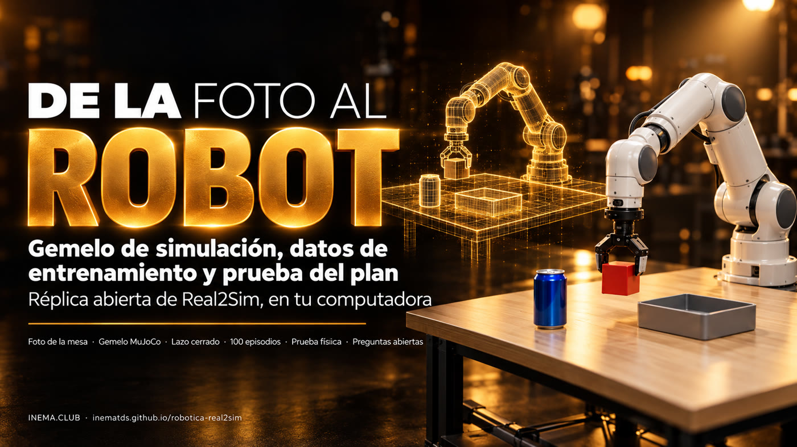

# robotica-real2sim

[](https://inematds.github.io/robotica-real2sim/guia/es/)

**De una foto de la mesa a un gemelo de simulación, a datos de entrenamiento etiquetados y a la prueba del plan antes de que el robot real se mueva.** Réplica abierta y local de la idea «Real2Sim» que Google mostró en la sección de robótica de Gemini 4 Argon (13/10/2026), hecha con MuJoCo, el brazo Franka Panda de MuJoCo Menagerie y Codex con la suscripción en lugar de Argon.

[🇧🇷 Português](README.md) · [🇺🇸 English](README.en.md) · 🇪🇸 Español · [Guía ilustrada](https://inematds.github.io/robotica-real2sim/guia/es/)

## Qué es

robotica-real2sim es un proyecto abierto que reproduce en tu computadora la idea que Google mostró en la parte de robótica de Gemini 4 Argon: tomar una foto de una mesa y convertirla en una simulación física donde un brazo robótico entrena. Sirve para quien quiere entender y probar robótica con IA sin tener un robot. Arma el "gemelo" de la mesa, genera decenas de intentos etiquetados para entrenamiento y prueba cada plan en la simulación antes de enviarlo a un robot real. Necesita Python, MuJoCo (simulador gratuito) y, para leer la foto, Codex.

> **Réplica didáctica, no es Argon.** El código de aquí no llama a la API de Gemini. Reproduce el
> *flujo* descrito por Google (foto → escena MuJoCo → generador de movimiento en bucle cerrado →
> episodios con variaciones → prueba en la física) con herramientas abiertas, y mide lo que funciona. Lo que
> Google midió con Argon está en [docs/PESQUISA.md](docs/PESQUISA.md), con fuentes.

## Qué hace

```
foto.jpg ──(modelo de visión)──> escena.json ──> gemelo MuJoCo (Panda + mesa + objetos)
                                                     │
            «todo lo redondo va a la bandeja»         ├──> generador de movimiento en bucle cerrado (IK)
                          │                            ├──> 50 episodios con variaciones + anotación en 4 niveles
                 (Codex planifica)                      └──> video del episodio (3 cámaras)
                          ▼
                   plan.json ──> PRUEBA: 20 variaciones en la física ──> APROBADO / REPROBADO
```

| Etapa | Comando | Qué se obtiene |
|---|---|---|
| Foto → escena | `./r2s.py foto foto.jpg escena.json` | objetos, tamaños y posiciones en metros, calibrados con una hoja A4 |
| Ver el gemelo | `./r2s.py ver escena.json gemeo.png --camera cima` | imagen de la simulación para comparar con la foto |
| Grabar | `./r2s.py filmar escena.json ep.mp4 --cameras geral,cima,pulso` | MP4 con la fase escrita en pantalla |
| Datos | `./r2s.py episodios escena.json saida/ -n 50 --imagens` | `ep_NNNN.npz` (articulaciones, pinza, TCP, objeto, imágenes) + `ep_NNNN.json` (anotación) |
| Planificar | `./r2s.py planejar escena.json "pedido" plano.json` | pasos tomar → destino escritos por Codex |
| Probar | `./r2s.py provar escena.json plano.json -n 20` | tasa de éxito, fallos por paso, APROBADO si ≥ 90% |
| Todo | `./r2s.py tudo foto.jpg pasta/` | las cuatro primeras etapas de una vez |

## Resultados medidos (14/10/2026, CPU ARM de 20 núcleos, MuJoCo 3.15)

| Medición | Resultado |
|---|---|
| Foto → escena (Codex, `gpt-6-luna`) | 4 objetos en ~9 s, cubo a la izquierda y bandeja a la derecha, como en la foto |
| Episodios `mesa-foto` (cubo → bandeja, con variaciones) | **50/50** en 8,7 s |
| Episodios `mesa-teste` | **50/50** en 8,4 s |
| Cada objeto por separado (cubo, lata, pelota × 2 escenas, 20 variaciones) | **20/20** en todos |
| Plan ingenuo de Codex «todo lo redondo va a la bandeja» | **4/20 (20%) → REPROBADO**: la pelota cae encima de la lata |
| El mismo plan con un espacio por objeto | **19/20 (95%) → APROBADO** |
| Pruebas (`python3 testes/rodar.py`) | 8/8 en 11 s |

Archivos: [resultados/](resultados/) (resúmenes, plan, pruebas y los 100 episodios).


**Codex × Claude × Gemini:** la misma foto y el mismo pedido corrieron en Codex, Claude (`--motor claude`), Gemini Robotics-ER 2 (`--motor gemini`) y Gemini 4 Argon vía OpenRouter (`--motor openrouter`). Claude, ER y Argon midieron la mesa con fidelidad; Argon fue el único con escena fiel y plan aprobado (100%), en 7 s y por US$ 0,01. Detalles en [docs/CODEX-VS-CLAUDE.md](docs/CODEX-VS-CLAUDE.md) (en portugués).

## Instalar y ejecutar

```bash
git clone https://github.com/inematds/robotica-real2sim && cd robotica-real2sim
./instalar.sh                     # venv + MuJoCo + Panda de Menagerie + pruebas
./r2s.py filmar exemplos/mesa-teste/cena.json ep.mp4 --cameras geral,cima,pulso
./r2s.py provar exemplos/mesa-foto/cena.json resultados/mesa-foto/plano.json --sem-vagas
./r2s.py provar exemplos/mesa-foto/cena.json resultados/mesa-foto/plano.json
```

Sin monitor (servidor, WSL), el renderizado usa `MUJOCO_GL=egl`; sin GPU, `MUJOCO_GL=osmesa`.
Las etapas **foto → escena** y **planificar** usan Codex CLI (`codex login`). Si no lo tienes, escribe
`cena.json` a mano (modelo en [exemplos/mesa-teste/cena.json](exemplos/mesa-teste/cena.json)) o pega el
`PROMPT` de [real2sim/foto2cena.py](real2sim/foto2cena.py) en cualquier chat con visión.

## Cómo funciona por dentro

- **`cena2mjcf.py`** construye el MJCF con `MjSpec`: el Panda de Menagerie, una mesa, luces, tres cámaras
  (general, desde arriba, en la muñeca) y los objetos. Rechaza escenas fuera del alcance del brazo (0,25–0,80 m).
- **`gerador.py`** es el generador de movimiento en bucle cerrado: cada 20 ms lee dónde está el objeto,
  recalcula el objetivo y resuelve la cinemática inversa diferencial (mínimos cuadrados amortiguados, postura
  de descanso solo en el espacio nulo, comando integrado con anti-windup). Fases: acercarse, descender, cerrar,
  subir, llevar, bajar, abrir, retroceder. El éxito se comprueba con la física (objeto dentro del recipiente).
- **`episodios.py`** genera variaciones aleatorias (posición ±4 cm, giro ±0,6 rad, masa ±30%) y guarda cada
  episodio con anotación «a posteriori» en 4 niveles: objetivo → subtareas (tomar, llevar, soltar)
  → primitivas con inicio y fin → eventos (contacto de ambos dedos, objeto levantado, éxito). Los episodios
  fallidos quedan con `peso_no_treino: 0`, como en el control de calidad del ejemplo ALOHA 2 de Google.
- **`provar.py`** le pide el plan a Codex, comprueba que solo mencione objetos existentes, distribuye espacios en
  el recipiente y ejecuta el plan N veces con variaciones. Solo aprueba si supera el mínimo.

## Lo que mostró Google (resumen; fuentes en [docs/PESQUISA.md](docs/PESQUISA.md))

- **ERQA** (razonamiento incorporado): 87%, por encima de todos los modelos de frontera.
- **A partir de una foto**: mesa de trabajo con 2 brazos Franka FR3 → gemelo MuJoCo → 77 tareas → generador IK en bucle
  cerrado → más de 4.500 episodios → ajuste de un VLA → **56% → 75%** de éxito en el robot real, **35 s → 24 s**.
- **Spot** entrena en el gemelo del bote de basura con pedal antes de pisar el real; **SO-101** mejora por sí mismo
  (58,9 s → 22,9 s → 17,4 s) bajo las reglas de un `AGENTS.md`; **ALOHA 2** recibe anotaciones en 4 niveles
  (1 objetivo, 6 subtareas, 17 primitivas) con control de calidad.
- **DroneBench** (Andon Labs): modelos que escriben código para que un dron de US$ 129 encuentre y siga a una
  persona. El mejor modelo completó el 84% del recorrido; nadie completa aún las 5 tareas.
- Acceso a Argon: AI Studio (Ultra), Gemini API de pago (`gemini-4-argon`), Antigravity.

## Preguntas que esto plantea

Auto-mejora recursiva, vigilancia barata, jailbreak de robots, simulación que miente, propiedad de los
datos, empleo, modelo que escribe su propia prueba y regulación: cada tema está desarrollado, con fuentes y con lo que
midió este repositorio, en **[docs/QUESTOES.md](docs/QUESTOES.md)**.

**Humanoides:** ¿Real2Sim acelera el entrenamiento de humanoides? Cifras de NVIDIA (GR00T N1, Isaac Lab con Unitree G1), dónde más ayuda la simulación, la brecha de realidad y dónde entra este proyecto, con fuentes verificadas en **[docs/HUMANOIDES.md](docs/HUMANOIDES.md)** (en portugués).

**En la práctica:** cómo el robot recibe instrucciones (plan → movimiento → motor), cómo son los datos, cómo aprende en el mundo real y el paso a paso para quien tiene un **SO-101**, en **[docs/APRENDER.md](docs/APRENDER.md)** (en portugués). Los episodios se exportan al formato de **LeRobot** con `./instalar.sh --lerobot` y `./r2s.py exportar <episodios> <salida>` (50 episodios con cámaras → 4.361 cuadros, 9,7 MB).

## Próximos pasos para quienes quieran pasar al mundo real

1. Cambiar el Panda por un **SO-101** (Menagerie tiene `robotstudio_so101`; kit de ~US$ 100 a 500) y
   grabar con **LeRobot**.
2. Convertir los episodios al formato de LeRobot y ajustar una política abierta (OpenVLA, pi0).
3. Nunca enviar al brazo real un plan que no haya pasado por `r2s.py provar`.

## Licencia

MIT para el código de este repositorio. El modelo del Franka Panda proviene de
[MuJoCo Menagerie](https://github.com/google-deepmind/mujoco_menagerie) (Apache-2.0) y se descarga mediante
`instalar.sh`; no se redistribuye aquí. La foto de ejemplo se generó con IA.

Hecho por [INEMA.CLUB](https://inema.club).