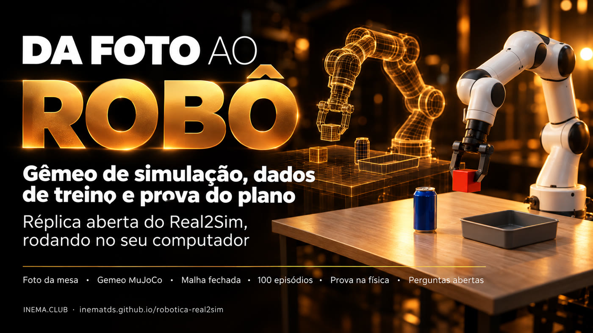

# robotica-real2sim

[](https://inematds.github.io/robotica-real2sim/guia/)

**De uma foto da mesa a um gêmeo de simulação, a dados de treino rotulados e à prova do plano
antes de o robô real se mexer.** Réplica aberta e local da ideia "Real2Sim" que o Google mostrou na
parte de robótica do Gemini 4 Argon (13/10/2026), feita com MuJoCo, o braço Franka Panda do MuJoCo
Menagerie e o Codex pela assinatura no lugar do Argon.

🇧🇷 Português · [🇺🇸 English](README.en.md) · [🇪🇸 Español](README.es.md) · [Guia ilustrado](https://inematds.github.io/robotica-real2sim/guia/)

## O que é

O robotica-real2sim é um projeto aberto que reproduz no seu computador a ideia que o Google mostrou na parte de robótica do Gemini 4 Argon: tirar uma foto de uma mesa e transformá-la numa simulação física onde um braço robótico treina. Serve para quem quer entender e testar robótica com IA sem ter robô. Ele monta o "gêmeo" da mesa, gera dezenas de tentativas rotuladas para treino e testa cada plano na simulação antes de mandá-lo a um robô real. Precisa de Python, do MuJoCo (simulador gratuito) e, para ler a foto, do Codex.

> **Réplica didática, não o Argon.** O código aqui não chama a API do Gemini. Ele reproduz o
> *fluxo* descrito pelo Google (foto → cena MuJoCo → gerador de movimento em malha fechada →
> episódios com variação → prova na física) com ferramentas abertas, e mede o que roda. O que o
> Google mediu com o Argon está em [docs/PESQUISA.md](docs/PESQUISA.md), com fonte.

## O que ele faz

```
foto.jpg ──(modelo de visão)──> cena.json ──> gêmeo MuJoCo (Panda + mesa + objetos)
                                                 │
            "tudo que é redondo vai à bandeja"   ├──> gerador de movimento em malha fechada (IK)
                       │                          ├──> 50 episódios com variação + anotação em 4 níveis
                (Codex planeja)                   └──> filme do episódio (3 câmeras)
                       ▼
                 plano.json ──> PROVA: 20 variações na física ──> APROVADO / REPROVADO
```

| Etapa | Comando | O que sai |
|---|---|---|
| Foto → cena | `./r2s.py foto foto.jpg cena.json` | objetos, tamanhos e posições em metros, calibrados por uma folha A4 |
| Ver o gêmeo | `./r2s.py ver cena.json gemeo.png --camera cima` | imagem da simulação para comparar com a foto |
| Filmar | `./r2s.py filmar cena.json ep.mp4 --cameras geral,cima,pulso` | MP4 com a fase escrita na tela |
| Dados | `./r2s.py episodios cena.json saida/ -n 50 --imagens` | `ep_NNNN.npz` (juntas, garra, TCP, objeto, imagens) + `ep_NNNN.json` (anotação) |
| Planejar | `./r2s.py planejar cena.json "pedido" plano.json` | passos pegar → destino escritos pelo Codex |
| Provar | `./r2s.py provar cena.json plano.json -n 20` | taxa de sucesso, falha por passo, APROVADO se ≥ 90% |
| Tudo | `./r2s.py tudo foto.jpg pasta/` | as quatro primeiras etapas de uma vez |

## Resultados medidos (14/10/2026, CPU ARM de 20 núcleos, MuJoCo 3.15)

| Medida | Resultado |
|---|---|
| Foto → cena (Codex, `gpt-6-luna`) | 4 objetos em ~9 s, cubo à esquerda e bandeja à direita como na foto |
| Episódios `mesa-foto` (cubo → bandeja, com variação) | **50/50** em 8,7 s |
| Episódios `mesa-teste` | **50/50** em 8,4 s |
| Cada objeto sozinho (cubo, lata, bola × 2 cenas, 20 variações) | **20/20** em todos |
| Plano do Codex "tudo que é redondo vai para a bandeja", ingênuo | **4/20 (20%) → REPROVADO**: a bola cai em cima da lata |
| Mesmo plano com uma vaga por objeto | **19/20 (95%) → APROVADO** |
| Testes (`python3 testes/rodar.py`) | 8/8 em 11 s |

Arquivos: [resultados/](resultados/) (resumos, plano, provas e os 100 episódios).


**Codex × Claude × Gemini:** a mesma foto e o mesmo pedido rodaram no Codex, no Claude (`--motor claude`), no Gemini Robotics-ER 2 (`--motor gemini`) e no Gemini 4 Argon pela OpenRouter (`--motor openrouter`). Claude, ER e Argon mediram a mesa com fidelidade; o Argon foi o único com cena fiel e plano aprovado (100%), em 7 s e por US$ 0,01. Detalhes em [docs/CODEX-VS-CLAUDE.md](docs/CODEX-VS-CLAUDE.md).

## Instalar e rodar

```bash
git clone https://github.com/inematds/robotica-real2sim && cd robotica-real2sim
./instalar.sh                     # venv + MuJoCo + Panda do Menagerie + testes
./r2s.py filmar exemplos/mesa-teste/cena.json ep.mp4 --cameras geral,cima,pulso
./r2s.py provar exemplos/mesa-foto/cena.json resultados/mesa-foto/plano.json --sem-vagas
./r2s.py provar exemplos/mesa-foto/cena.json resultados/mesa-foto/plano.json
```

Sem monitor (servidor, WSL), a renderização usa `MUJOCO_GL=egl`; sem GPU, `MUJOCO_GL=osmesa`.
A etapa **foto → cena** e **planejar** usam o Codex CLI (`codex login`). Sem ele, escreva a
`cena.json` à mão (modelo em [exemplos/mesa-teste/cena.json](exemplos/mesa-teste/cena.json)) ou cole o
`PROMPT` de [real2sim/foto2cena.py](real2sim/foto2cena.py) em qualquer chat com visão.

## Como funciona por dentro

- **`cena2mjcf.py`** monta o MJCF com `MjSpec`: o Panda do Menagerie, uma mesa, luzes, três câmeras
  (geral, de cima, no pulso) e os objetos. Recusa cena fora do alcance do braço (0,25–0,80 m).
- **`gerador.py`** é o gerador de movimento em malha fechada: a cada 20 ms lê onde o objeto está,
  recalcula o alvo e resolve a cinemática inversa diferencial (mínimos quadrados amortecidos, postura
  de descanso só no espaço nulo, comando integrado com anti-windup). Fases: aproximar, descer, fechar,
  subir, levar, baixar, abrir, recuar. Sucesso é conferido pela física (objeto dentro do recipiente).
- **`episodios.py`** sorteia variações (posição ±4 cm, giro ±0,6 rad, massa ±30%) e grava cada
  episódio com anotação "em retrospecto" em 4 níveis: objetivo → subtarefas (pegar, levar, soltar)
  → primitivas com início e fim → eventos (contato dos dois dedos, objeto levantado, sucesso). Episódio
  que falhou fica com `peso_no_treino: 0`, como o controle de qualidade do exemplo ALOHA 2 do Google.
- **`provar.py`** pede o plano ao Codex, confere que só cita objetos que existem, distribui vagas no
  recipiente e roda o plano N vezes com variação. Só aprova acima do mínimo.

## O que o Google mostrou (resumo; fontes em [docs/PESQUISA.md](docs/PESQUISA.md))

- **ERQA** (raciocínio incorporado): 87%, acima de todo modelo de fronteira.
- **De uma foto**: bancada com 2 braços Franka FR3 → gêmeo MuJoCo → 77 tarefas → gerador IK em malha
  fechada → 4.500+ episódios → ajuste de um VLA → **56% → 75%** de sucesso no robô real, **35 s → 24 s**.
- **Spot** treina no gêmeo da lixeira com pedal antes de pisar na real; **SO-101** melhora a si mesmo
  (58,9 s → 22,9 s → 17,4 s) sob regras de um `AGENTS.md`; **ALOHA 2** ganha anotação em 4 níveis
  (1 objetivo, 6 subtarefas, 17 primitivas) com controle de qualidade.
- **DroneBench** (Andon Labs): modelos escrevendo código para um drone de US$ 129 achar e seguir uma
  pessoa. Melhor modelo a 84% do caminho; ninguém fecha as 5 tarefas ainda.
- Acesso ao Argon: AI Studio (Ultra), Gemini API paga (`gemini-4-argon`), Antigravity.

## Perguntas que isso levanta

Autoaperfeiçoamento recursivo, vigilância barata, jailbreak de robô, simulação que mente, dono dos
dados, emprego, modelo que escreve a própria prova e regulação: cada uma ampliada, com fonte e com o
que este repositório mediu, em **[docs/QUESTOES.md](docs/QUESTOES.md)**.

## Próximos passos para quem quer ir ao real

1. Trocar o Panda por um **SO-101** (Menagerie tem `robotstudio_so101`; kit de ~US$ 100 a 500) e
   gravar com o **LeRobot**.
2. Converter os episódios para o formato do LeRobot e ajustar uma política aberta (OpenVLA, pi0).
3. Nunca mandar ao braço real um plano que não passou por `r2s.py provar`.

## Licença

MIT para o código deste repositório. O modelo do Franka Panda vem do
[MuJoCo Menagerie](https://github.com/google-deepmind/mujoco_menagerie) (Apache-2.0) e é baixado pelo
`instalar.sh`, não redistribuído aqui. A foto de exemplo foi gerada por IA.

Feito pelo [INEMA.CLUB](https://inema.club).
